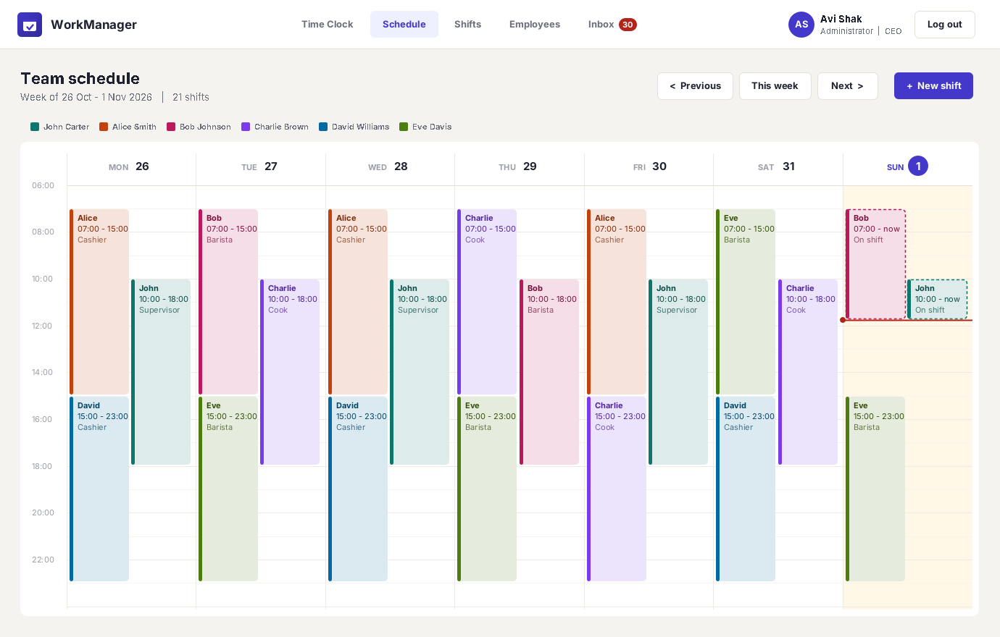
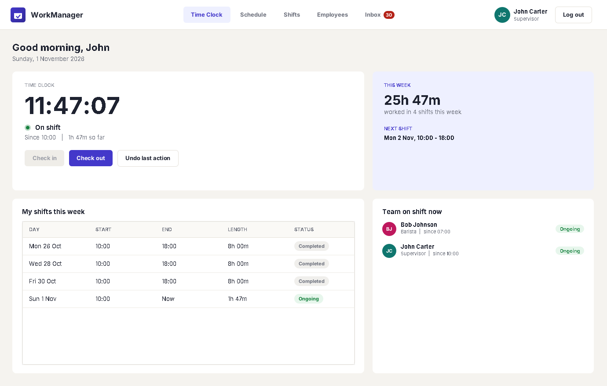
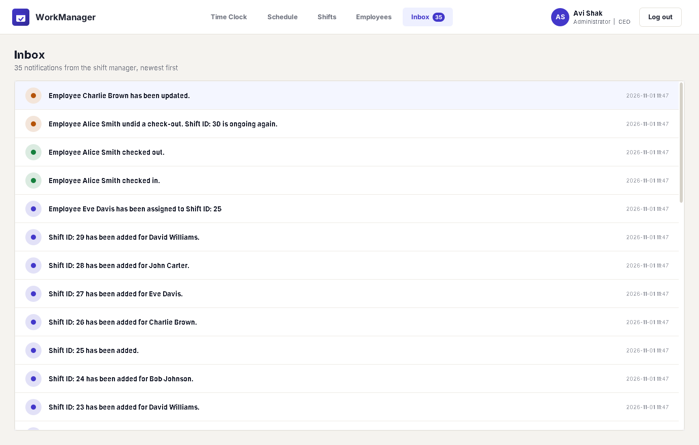
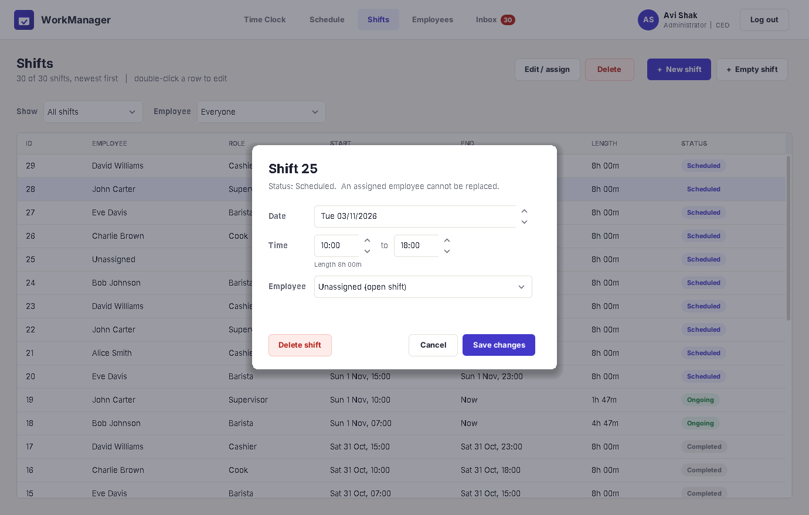
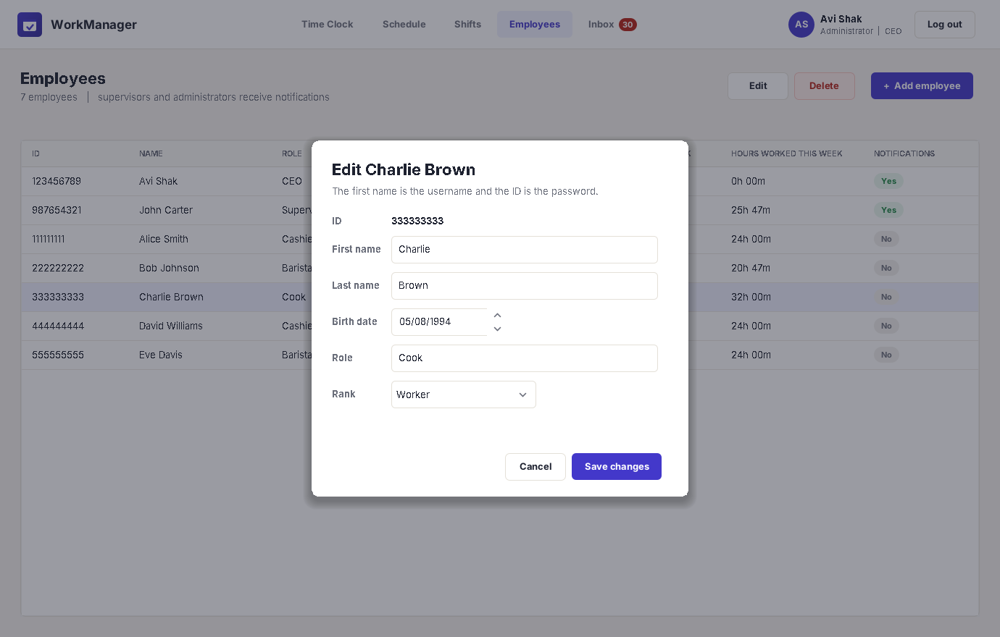

# WorkManager (Shift Management System)

A Java application for managing employees, shifts and attendance in a workplace, built around **object-oriented design and design patterns**: Factory, Singleton, Observer and Memento. It was developed as a Java OOP project and later extended with a **Swing desktop interface**.



---

## About

Employees sign in with their first name as the username and their 9-digit ID as the password. What they can do depends on their rank:

| Rank | Permissions |
|---|---|
| **Worker** | Check in and out, undo the last check-in or check-out, view their own shifts by day, week or month |
| **Supervisor** | Everything a worker can do, plus assign employees to shifts, update shift times, search all shifts, and update workers and supervisors |
| **Administrator** | Everything, including adding and deleting shifts and employees, and updating administrators |

The system protects itself from invalid states: the last administrator cannot be deleted, no one can delete themselves, an employee cannot check in twice, and an assigned shift cannot be given to someone else.

The project has two front ends over the same managers:

- **Swing interface** (`gui.ShiftManagerApp`): a desktop app with a time clock, a weekly calendar, shift and employee management, and a notification inbox. It opens with a sample week of shifts.
- **Console application** (`WorkPlaceManeger.ShiftManagementSystem`): the original text menu. It starts with the predefined employees and no shifts.

---

## Architecture

The core logic is separate from the user interfaces. Both entry points create the same two managers, wired together the same way, and work through them:

```
gui.ShiftManagerApp              WorkPlaceManeger.ShiftManagementSystem
(Swing pages and dialogs)        (console menus)
        |                                |
        +---------------+----------------+
                        |
         ShiftManager <---> EmployeeDataBase
              |                   |
  Shift, CheckInOutRecord   Employee, DataBase
```

- **`ShiftManager`** owns the shifts and one check-in record per employee, and handles check-in, check-out, undo and shift changes. It is also the Observer subject.
- **`EmployeeDataBase`** owns the employees and handles signing in and adding, updating and deleting employees. It creates employees through `EmployeeFactory` and keeps credentials in the `DataBase` singleton.
- **Shared operations:** each manager has core methods that take plain parameters and report a broken rule by throwing an exception. The Swing interface calls these directly. The managers also have console-only methods that read input, call the same core methods and print the result.

**Where the rules live:** the managers enforce data and state rules, such as the protections listed under About, valid shift times, ID and name formats, and who may update whom and to which rank. Other rank restrictions are applied at the interface level: each front end decides which menus, pages and buttons a rank can reach, including adding and deleting shifts and employees.

**Undo with Memento:** before a check-in or check-out, `ShiftManager` has the employee's `CheckInOutRecord` save the shift's start and end times as a `ShiftMemento`. The record keeps these on a stack, so undo restores the most recent state first. Undoing a check-out makes the shift ongoing again, and undoing a check-in removes the shift that the check-in created.

---

## Object-Oriented Design

| Concept | Where it appears |
|---|---|
| **Inheritance** | The abstract `Person` class is extended by `Employee` |
| **Interfaces** | `IEmployeeManagement` and `IShiftManagement` define the operations that the managers implement, and `IFunctionsLab` holds the shared input validation |
| **Enums** | `Rank` (worker, supervisor, administrator) drives the permissions |
| **Encapsulation** | Both front ends go through `ShiftManager` and `EmployeeDataBase`, which enforce the data and state rules (see [Architecture](#architecture)) |

### Design Patterns

| Pattern | Implementation |
|---|---|
| **Factory** | `EmployeeFactory` creates every employee |
| **Singleton** | `DataBase` holds the usernames and passwords and has a single instance |
| **Observer** | `ShiftManager` is the subject and supervisors and administrators are observers. Every change to shifts or employees sends them a notification, which the interface shows in their inbox |
| **Memento** | Before each check-in or check-out, the shift's state is saved as a `ShiftMemento` in the employee's `CheckInOutRecord`. **Undo** restores the last saved state, in reverse order |

<table>
  <tr>
    <td></td>
    <td></td>
  </tr>
  <tr>
    <td align="center"><sub><b>Time clock: check in, check out and undo (Memento)</b></sub></td>
    <td align="center"><sub><b>Notification inbox (Observer)</b></sub></td>
  </tr>
</table>

---

## The Swing Interface

Built with Swing and custom Java2D drawing, with no external libraries.

- **Sign in** with demo account buttons for each rank.
- **Time clock** with a live clock, the current shift and its length, the week's hours, the next shift and who is on shift now.
- **Weekly calendar** with a colour for each employee, open shifts, ongoing shifts and a current-time line. Workers see only their own shifts.
- **Shifts** table with filters by period and employee. Shifts can be created, edited, assigned and deleted according to rank.
- **Employees** table with hours this week, and add, edit and delete forms that use the same rank rules as the console.
- **Inbox** with the notifications the logged-in employee received as an observer.
- A built-in **screenshot mode** that saves an image of every screen.

<table>
  <tr>
    <td></td>
    <td></td>
  </tr>
  <tr>
    <td align="center"><sub><b>Assigning an employee to an open shift</b></sub></td>
    <td align="center"><sub><b>Editing an employee, with rank rules</b></sub></td>
  </tr>
</table>

---

## Project Structure

```
AbstractClasses/       # Person (abstract base class)
Enums/                 # Rank
Factories/             # EmployeeFactory (Factory pattern)
Interfaces/            # Management interfaces, Observer, Subject, IFunctionsLab (input validation)
Manegers/              # ShiftManager (Observer subject), EmployeeDataBase, DataBase (Singleton)
SingleObjectClasses/   # Employee, Shift, ShiftMemento, CheckInOutRecord (Memento), Date
WorkPlaceManeger/      # ShiftManagementSystem (console entry point)
gui/                   # Swing interface (ShiftManagerApp entry point)
docs/screenshots/      # Images used in this README
```

---

## Getting Started

Requires **JDK 11 or newer**. The project uses only the Java standard library, so there are no external dependencies to install.

The compiler and the runtime must use compatible JDK versions, so check both first:

```bash
java -version
javac -version
```

The `java` version must be the same as or newer than the version the code was compiled for. The commands below use `--release 11`, which targets Java 11. If `java` is older than that, the program stops with an `UnsupportedClassVersionError`. The code compiles with `--release 11` and has been run on JDK 21. It has not been run on a Java 11 runtime.

**In an IDE** (IntelliJ IDEA, Eclipse or VS Code with the Extension Pack for Java), open the project folder and run:

- `gui/ShiftManagerApp.java` for the Swing interface, or
- `WorkPlaceManeger/ShiftManagementSystem.java` for the console version.

**From the command line**, in the project folder:

```bash
# Compile (Linux / macOS / Git Bash)
javac --release 11 -d out $(find . -name "*.java")

# Compile (Windows PowerShell)
javac --release 11 -d out (Get-ChildItem -Recurse -Filter *.java).FullName

# Run the Swing interface
java -cp out gui.ShiftManagerApp

# Run the console version
java -cp out WorkPlaceManeger.ShiftManagementSystem

# Save a screenshot of every screen
java -cp out gui.ShiftManagerApp --screenshots screenshots
```

### Demo Accounts

| Rank | Username | Password |
|---|---|---|
| Administrator | `Avi` | `123456789` |
| Supervisor | `John` | `987654321` |
| Worker | `Alice` | `111111111` |

New employees sign in the same way: their first name is the username and their ID is the password.

---

## Recent Improvements

Alongside the interface, several bugs in the original code were fixed:

- Every login and every new user printed the password to the console in debug messages.
- Minutes and seconds accepted 60, and every month accepted day 31, which crashed shift updates with a `DateTimeParseException`.
- Shift dates were limited to 2024, because they used the same year range as birth dates.
- The Memento classes were never connected to a menu. Check-in and check-out can now be undone.
- An employee could check in again while already on shift.
- Updating an employee did not allow keeping the same first name, asked for every field before saying an administrator cannot be updated, let a supervisor promote someone (including themselves) to administrator, and replaced the employee with a new object, which disconnected them from their shifts.
- IDs that start with 0 could not be entered, because they were read as numbers.
- Updating a shift sent every observer the same notification twice.
- Shifts planned for the future were shown as "Completed". Shifts now show Not scheduled, Scheduled, In progress, Ongoing or Completed.

---

## Limitations

- Application data is stored in memory and is not saved between runs.
- Sign-in uses simple demo credentials, with the employee ID as the password, and is not intended for production security.
- The repository does not currently include automated tests.

---

## License

Released under the [MIT License](LICENSE).
